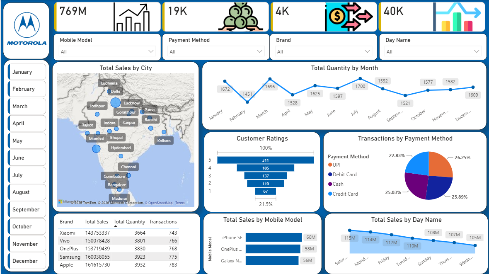

# Mobile Sales Dashboard - Power BI

### Dashboard Preview

### Overview
End-to-end Power BI dashboard analyzing 3835 mobile transactions across India. Achieved 769M revenue, 19K units, 4K orders from Oct 2021 onwards.

### Tools Used
Power BI Desktop, Power Query, DAX, Data Modeling & Visualization

### KPIs Achieved
- **Total Sales:** 769M (Fixed using SUMX - Units * Price)
- **Total Units Sold:** 19K
- **Total Orders:** 4K
- **Average Price:** 40K

### DAX Measures Fixed
- Total Sales = SUMX(Table, [Units Sold] * [Price Per Unit]) = 769M
- Total Units = SUM([Units Sold]) = 19K
- Total Orders = COUNT([Order ID]) = 4K
- Avg Price = AVERAGE([Price Per Unit]) = 40K

### Key Insights
1. Apple leads with 161M revenue - Premium segment dominates
2. Delhi (1008) & Mumbai (654) are top 2 cities - 43% business from 2 cities
3. UPI is #1 payment method with 26.25% share, followed by Cash 25.89%
4. Customer satisfaction is high - 311 customers gave 5-star rating (highest)
5. Sales are consistent across all months (1528 - 1696 units)
6. OnePlus, Samsung are also strong performers (58M-60M each)

### Dashboard Features
- 4 KPI Cards with icons
- India Map - Total Sales by City
- Line Chart - Total Quantity by Month
- Funnel Chart - Customer Ratings
- Pie Chart - Transactions by Payment Method
- Table - Brand wise Sales
- Bar Charts - Sales by Model & Day Name
- 4 Slicers - Model, Payment, Brand, Day Name + Month Filter

### Files in Repo
- Mobile-Sales-Dashboard-PowerBI.png - Final Dashboard (769M)
- Mobile Sales Dashboard.pbix - Power BI Source File
- Day - 30 - Mobile Sales Data.xlsx - Raw Data (3835 Rows)

### What I Fixed
Earlier Total Sales was showing 68M (SUM of Price column). Fixed it to 769M by using correct DAX: SUMX with Units * Price. Now dashboard shows accurate business metrics.
